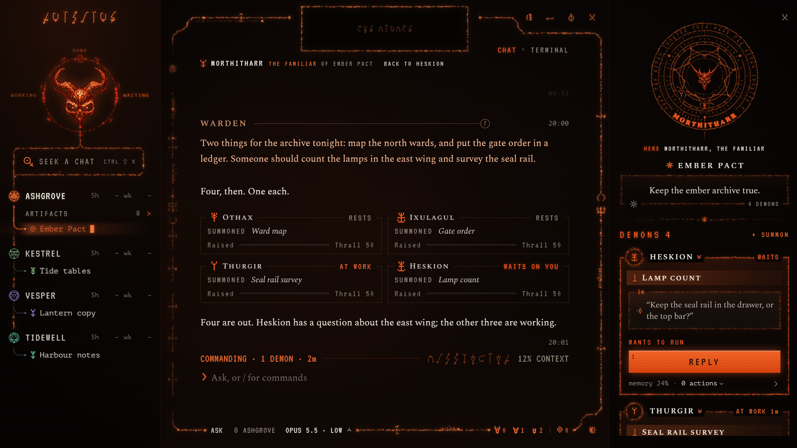

# Grimoire

One window for your Claude Code sessions, from Infernal Intelligence. Your accounts and
pacts sit on the left, Claude Code runs on the right, and you can summon demons to
work beside you while a Familiar keeps the pact.

## Download

- **Windows 10 or 11 (x64):** [Grimoire-Setup.exe](https://github.com/thoughtform-co/grimoire/releases/latest/download/Grimoire-Setup.exe)
- **macOS 12 or later (Apple silicon and Intel):** [Grimoire.dmg](https://github.com/thoughtform-co/grimoire/releases/latest/download/Grimoire.dmg)

Every edition, with its notes, is on the [Releases](https://github.com/thoughtform-co/grimoire/releases) page.



## What you need

- **Claude Code**, installed by you:
  - Windows, in PowerShell: `irm https://claude.ai/install.ps1 | iex`
  - macOS, in Terminal: `curl -fsSL https://claude.ai/install.sh | bash`
- **Your own Claude subscription** (Pro, Max, Team or Enterprise) or your own Anthropic
  API key. You sign in inside Claude Code the first time it starts, never inside the
  Grimoire.

If Claude Code is missing, the Grimoire still opens and its first tab says how to
install it.

## The first time you open it

The installers are not code-signed yet, so your computer warns you once.

**Windows.** SmartScreen says "Windows protected your PC". Click **More info**, then
**Run anyway**. The Grimoire installs for your user only and needs no administrator
rights.

**macOS.** The app is not signed with an Apple Developer ID and not notarized by
Apple. macOS will either say that "Grimoire is damaged and can't be opened", or that
it cannot verify the developer. Either way:

1. Drag Grimoire into Applications.
2. Run this once in Terminal:

   ```
   xattr -dr com.apple.quarantine /Applications/Grimoire.app
   ```

3. Open Grimoire again.

## How it uses Claude Code

The Grimoire starts the Claude Code you installed, unmodified, signed in with your own
account. Your usage is billed to that account, under your own agreement with Anthropic.
The Grimoire never sees your login.

Using Claude Code through the Grimoire is governed by Anthropic's terms for your account:

- [Claude Code legal and compliance](https://code.claude.com/docs/en/legal-and-compliance)
- the [Consumer Terms](https://www.anthropic.com/legal/consumer-terms) or the
  [Commercial Terms](https://www.anthropic.com/legal/commercial-terms)
- the [Usage Policy](https://www.anthropic.com/legal/aup)

The Grimoire is an independent project. It is not affiliated with Anthropic, and
Anthropic does not endorse it. Claude and Claude Code are trademarks of Anthropic.

## Licence

- **The Grimoire:** free to download and use. © 2026 Thoughtform.
- **Source code:** not published. This repository holds the releases only.
- **Names and art:** the Grimoire and Infernal Intelligence names, the marks, the icon
  and the art are reserved.
- **Third-party software:** the open-source software the app ships with is listed,
  with each licence, in [THIRD-PARTY-NOTICES.md](THIRD-PARTY-NOTICES.md).

## Problems and ideas

Open an [issue](https://github.com/thoughtform-co/grimoire/issues).
