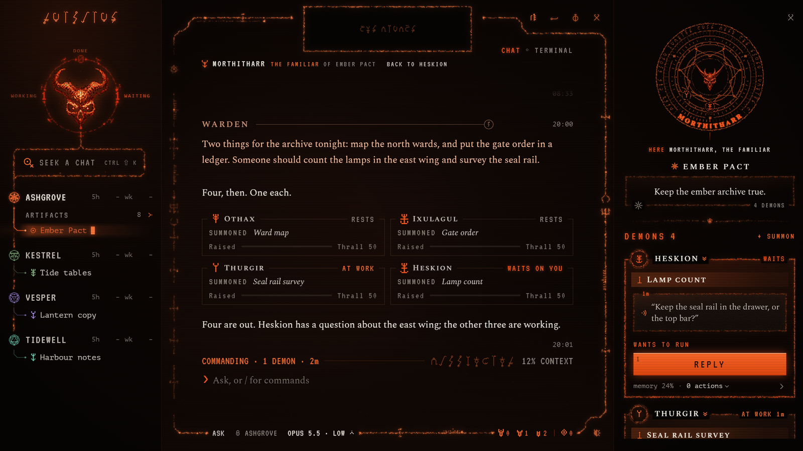

# Grimoire

One window for your Claude Code sessions, from Infernal Intelligence. Your accounts and
pacts sit on the left, Claude Code runs on the right, and you can summon demons to
work beside you while a Familiar keeps the pact.

## Download

- **Windows 10 or 11 (x64):** [Grimoire-Setup.exe](https://github.com/thoughtform-co/grimoire/releases/latest/download/Grimoire-Setup.exe)
- **macOS 12 or later (Apple silicon and Intel):** [Grimoire.dmg](https://github.com/thoughtform-co/grimoire/releases/latest/download/Grimoire.dmg)
- **A Linux server (x64), for running it on a server:** [grimoire-server.sh](https://github.com/thoughtform-co/grimoire/releases/latest/download/grimoire-server.sh), which installs [Grimoire-linux-x64.tar.gz](https://github.com/thoughtform-co/grimoire/releases/latest/download/Grimoire-linux-x64.tar.gz)

Every edition, with its notes, is on the [Releases](https://github.com/thoughtform-co/grimoire/releases) page.



## Three ways to run it

| | Where the demons run | Good for | What you need |
|---|---|---|---|
| **1. On your computer** | your Mac or PC | trying it, working at one desk | the app |
| **2. On a server of yours, over Tailscale** | a Linux machine you already have that stays on (a home server, a spare PC) | demons that keep working while your laptop sleeps; one set of demons seen from your Mac and your PC | the app on each computer, Tailscale, the server script |
| **3. On a rented server** (Hetzner, or any VPS) | a Linux server you rent | the same as 2, without a machine at home | the same as 2, plus a server you rent and lock down |

Start with 1. You can move to 2 or 3 later: the app on your computer becomes a window
onto the server, with **THE HOST** in its settings.

### 1. On your computer

1. Install Claude Code and sign in once (see [What you need](#what-you-need)).
2. Download the Grimoire for your computer, above, and install it (see
   [The first time you open it](#the-first-time-you-open-it)).
3. Open it and click **CLAUDE** in the column on the left (Ctrl+1, or Cmd+1 on a Mac).
   Claude Code starts inside the Grimoire.

### 2. On a server of yours, over Tailscale

The Grimoire's engine runs on the server, out of sight, and the app on your Mac or PC
shows it and types into it. Nothing is opened to the internet: the engine answers only
on the server's Tailscale address, and only devices signed in to Tailscale as the same
user as the server can pair with it.

1. **Tailscale on both.** Install [Tailscale](https://tailscale.com/download) on your
   computer and on the server, and sign both in as the same Tailscale user. Do not tag
   the server.
2. **The engine on the server** (Ubuntu 22.04 or later, or Debian 12 or later, x64), in
   an SSH session as the user it should run as, not root:

   ```
   curl -fsSLO https://github.com/thoughtform-co/grimoire/releases/latest/download/grimoire-server.sh
   bash grimoire-server.sh install
   ```

   It downloads the Linux build, checks its checksum, installs it in your home folder
   and starts it as a service that survives reboots. It asks for `sudo` for three things
   only: system packages, Chromium's sandbox helper, and keeping the service running
   while nobody is logged in.
3. **Claude Code on the server**, signed in once:

   ```
   curl -fsSL https://claude.ai/install.sh | bash
   claude
   ```

   It prints a sign-in link: open it on your computer, then paste the code back. Then
   type `/exit`.
4. **Your computer as the window.** In the Grimoire on your computer, click the figure at
   the top of the left column, then **Settings**. Under **THE HOST**, choose **WINDOW ONTO
   YOUR SERVER**, type the server's Tailscale name (the install prints it) under
   **SERVER** and press **SET**.
5. **Pair it.** On the server, run `grimoire-pair <your-computer>`, using your computer's
   name as `tailscale status` lists it. Type the code it prints into **PAIRING CODE**,
   press **PAIR**, then **START AGAIN NOW**.

The Grimoire opens again as a window onto the server. Pair each computer you use the
same way; one types at a time, and **TAKE IT HERE** at the foot of the left column takes
the keyboard to the computer in front of you. More, including updates and removal:
[docs/server.md](docs/server.md).

### 3. On a rented server (Hetzner, or any VPS)

The same as 2, on a server you rent. Any provider works; the steps below use Hetzner
Cloud.

1. **Rent the server.** In the Hetzner Cloud console, create a server with Ubuntu 24.04,
   x86 (a shared CX or dedicated CCX type; 8 GB of memory runs a handful of demons, 16
   GB or more runs many), and add your SSH key.
2. **Your own user.** SSH in as root, then make a user for the Grimoire and give it your
   key and `sudo`:

   ```
   adduser grim
   usermod -aG sudo grim
   rsync --archive --chown=grim:grim ~/.ssh /home/grim
   ```

3. **Tailscale.** On the server: `curl -fsSL https://tailscale.com/install.sh | sh`, then
   `sudo tailscale up`, and sign in as your own Tailscale user (not with a tagged auth
   key). Check that `ssh grim@<server's Tailscale name>` works from your computer.
4. **Lock it down**, so the server is reachable only over Tailscale. Only after the
   Tailscale SSH check above works:

   ```
   sudo ufw default deny incoming
   sudo ufw default allow outgoing
   sudo ufw allow in on tailscale0
   sudo ufw allow 41641/udp
   sudo ufw enable
   ```

   If you lock yourself out, the Hetzner console's own terminal still reaches the server.
5. **Then steps 2 to 5 of way 2**, logged in over Tailscale as your user.

## What you need

- **Claude Code**, installed by you:
  - Windows, in PowerShell: `irm https://claude.ai/install.ps1 | iex`
  - macOS, in Terminal: `curl -fsSL https://claude.ai/install.sh | bash`
  - a Linux server: `curl -fsSL https://claude.ai/install.sh | bash`
- **Your own Claude subscription** (Pro, Max, Team or Enterprise) or your own Anthropic
  API key. You sign in inside Claude Code the first time it starts, never inside the
  Grimoire.

If Claude Code is missing, the Grimoire still opens and its first tab says how to
install it.

## The first time you open it

The installers are not code-signed yet, so your computer warns you once.

**Windows.** SmartScreen says "Windows protected your PC". Click **More info**, then
**Run anyway**. The Grimoire installs for your user only and needs no administrator
rights.

**macOS.** The app is not signed with an Apple Developer ID and not notarized by
Apple. macOS will either say that "Grimoire is damaged and can't be opened", or that
it cannot verify the developer. Either way:

1. Drag Grimoire into Applications.
2. Run this once in Terminal:

   ```
   xattr -dr com.apple.quarantine /Applications/Grimoire.app
   ```

3. Open Grimoire again.

## How it uses Claude Code

The Grimoire starts the Claude Code you installed, unmodified, signed in with your own
account. Your usage is billed to that account, under your own agreement with Anthropic.
The Grimoire never sees your login.

Using Claude Code through the Grimoire is governed by Anthropic's terms for your account:

- [Claude Code legal and compliance](https://code.claude.com/docs/en/legal-and-compliance)
- the [Consumer Terms](https://www.anthropic.com/legal/consumer-terms) or the
  [Commercial Terms](https://www.anthropic.com/legal/commercial-terms)
- the [Usage Policy](https://www.anthropic.com/legal/aup)

The Grimoire is an independent project. It is not affiliated with Anthropic, and
Anthropic does not endorse it. Claude and Claude Code are trademarks of Anthropic.

## Licence

- **The Grimoire:** free to download and use. © 2026 Thoughtform.
- **Source code:** not published. This repository holds the releases only.
- **Names and art:** the Grimoire and Infernal Intelligence names, the marks, the icon
  and the art are reserved.
- **Third-party software:** the open-source software the app ships with is listed,
  with each licence, in [THIRD-PARTY-NOTICES.md](THIRD-PARTY-NOTICES.md).

## Problems and ideas

Open an [issue](https://github.com/thoughtform-co/grimoire/issues).
